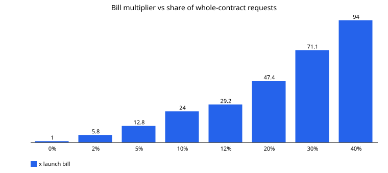
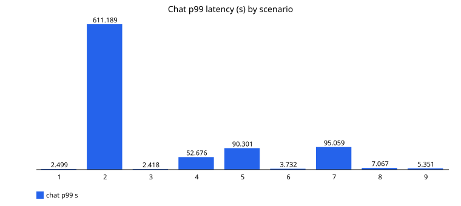
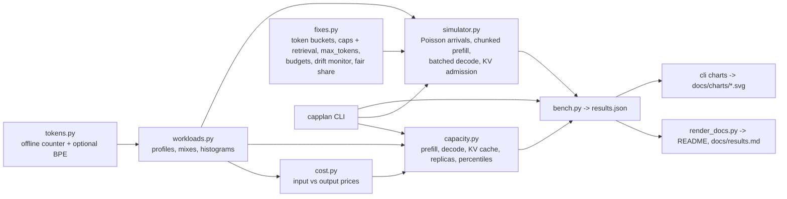

# LLM capacity planning: count tokens, not requests

**Recruiter summary.** A chatbot keeps the same users and never breaks its 100 requests-per-second limit,
yet its monthly bill jumps and its p99 latency explodes, because people start pasting whole contracts.
This repo shows why, with an offline token counter, workload profiles, a token-priced cost model, a
capacity planner (prefill vs decode, KV-cache memory, replicas, p50/p95/p99) and a fleet simulator that
reproduces the incident and measures six fixes before and after. Everything runs free on a laptop with
simulated models; no cloud and no paid APIs. Measured headline: same RPS, **32x** the bill and **245x**
the p99; input caps with retrieval plus fair-share admission bring chat p99 back from 611 s to 3.7 s
on the same three replicas.

All companies and tenants (Kestrel Lane Software and its "Brightdesk" assistant, Orchard Row Legal,
Pinecrest Mutual, Tidewater Clinics, Juniper Freight) are fictional.

## Why this exists

Requests per second is the right unit for web servers, connection pools and denial-of-service
protection, but it hides what an LLM actually does. One request can be 20 tokens or 90,000 tokens.
Cost and GPU time scale with tokens, input and output tokens behave differently, and averages hide
the tail that wrecks p99. See [docs/purpose.md](docs/purpose.md) and the plain-words
[explainer](docs/explainer.md).

## Results

<!-- results:start -->
**Tests: 132** (pytest, all passing). Every number below is produced by `capplan bench` from seeded
simulations and checked in CI against `results.json`. The models, GPUs and prices are simulated or
illustrative; the point is the method and the ratios, not the dollar amounts.

**The talk's arithmetic, recomputed.** 20 in / 30 out costs $0.000055; 8,000 in / 1,000 out costs
$0.0055, **100.0x** more. 100 RPS x 4,000 input = 400,000 input
tokens/s and x 500 output = 50,000 output tokens/s.

**The incident, reproduced (60 s of traffic at 100 RPS, measured, not forced).** Same request rate, same users,
average input up **164.9x**, monthly bill up **32.0x**, p99 latency up
**245.3x** (from 2.499 s to 613.014 s, a
queue that keeps growing for as long as the mix stays shifted). The talk's 80x needs about 30-40% whole-contract
traffic in this model: 0%: 1.0x | 2%: 5.8x | 5%: 12.8x | 10%: 24.0x | 12%: 29.2x | 20%: 47.4x | 30%: 71.1x | 40%: 94.0x.

| Scenario | Replicas | Avg input tokens | Monthly API bill | p99 all (s) | Chat p50 / p99 (s) | Rejected by token limits |
| --- | --- | --- | --- | --- | --- | --- |
| 1. Launch: chat-only mix, 3 replicas (the estimate) | 3 | 22.6 | $16,198 | 2.499 | 0.766 / 2.499 | 0 |
| 2. Incident: same RPS, 12% whole contracts, same 3 replicas | 3 | 3,725.9 | $519,079 | 613.014 | 302.396 / 611.189 | 0 |
| 3. Incident mix on the token-planned fleet | 47 | 3,725.9 | $519,079 | 22.639 | 0.764 / 2.418 | 0 |
| 4. Input cap + retrieval + max_tokens (3 replicas) | 3 | 358.2 | $77,567 | 70.192 | 21.687 / 52.676 | 0 |
| 5. Fair-share admission only (3 replicas) | 3 | 3,725.9 | $519,079 | 605.319 | 63.982 / 90.301 | 0 |
| 6. Caps + fair share (3 replicas) | 3 | 358.2 | $77,567 | 78.778 | 0.945 / 3.732 | 0 |
| 7. Per-user token bucket only (3 replicas) | 3 | 848.2 | $123,680 | 122.16 | 64.5 / 95.059 | 438 |
| 8. Caps + per-user and global token buckets + fair share (3 replicas) | 3 | 201.4 | $47,160 | 39.535 | 0.959 / 7.067 | 338 |
| 9. Caps on the fleet the planner sizes after caps | 5 | 358.2 | $77,567 | 26.813 | 1.04 / 5.351 | 0 |

**Capacity plans at 100 RPS** (20,000 sampled requests each; mean / p99 tokens):

| Mix | Input | Output | Prefill tok/s | Decode tok/s | KV cache GB | Replicas | API bill / month | GPU bill / month |
| --- | --- | --- | --- | --- | --- | --- | --- | --- |
| launch_estimate | 22.7 / 64 | 33.9 / 98 | 2,267 | 3,386 | 0.44 | 3 | $16,101 | $5,400 |
| month_after | 3,375.5 / 72,815 | 82.0 / 774 | 337,554 | 8,200 | 91.8 | 47 | $469,353 | $84,600 |
| code_assistant | 1,537.0 / 7,152 | 582.5 / 2,341 | 153,705 | 58,245 | 348.94 | 38 | $425,658 | $68,400 |
| doc_summarizer | 6,904.7 / 29,411 | 247.2 / 636 | 690,470 | 24,717 | 569.24 | 96 | $990,948 | $172,800 |

**Monitoring over a simulated month** (contract share ramps 0% to 12% over 10 days): the token-drift monitor
fires on day 2 (rolling mean 127.9 tokens vs a 56.5 baseline);
the spend alerts fire at 50% on day 4, 80% on day 5 and 100% on day 5; per-tenant budgets hard-stop
orchard-row-legal on day 3 while pinecrest-mutual, tidewater-clinics, juniper-freight never stop.
Without any fix the month would cost $398,601, **24.8x** the estimate.

**The talk's exercise** (inputs measured with the offline token counter on synthetic texts; outputs sampled from the profiles):

| Request type | Requests | Avg input | Avg output | p99 input | Avg cost | Output share of cost |
| --- | --- | --- | --- | --- | --- | --- |
| chat | 300 | 9.2 | 33.5 | 14 | $0.000055 | 91.6% |
| contract_qa | 300 | 4,613.8 | 447.3 | 8,927 | $0.002978 | 22.5% |
| code_gen | 300 | 1,008.4 | 708.4 | 1,813 | $0.001567 | 67.8% |
| summarization | 300 | 3,220.8 | 267.7 | 5,623 | $0.002012 | 20.0% |
<!-- results:end -->

Charts (generated by `capplan charts` from `results.json`):

| | |
| --- | --- |
|  |  |
|  |  |
|  |  |
|  | |

## Evidence board


One picture of the whole incident, drawn by `python scripts/evidence_board.py` from `results.json` only
(needs `pip install -e ".[board]"`). Panels (a)-(c) are simulated; panel (d) input tokens are measured with the
offline counter on synthetic texts and outputs are sampled; the 80x line is the talk's figure, quoted for
comparison. CI re-runs it with `--check` and fails if `docs/evidence_board.json` drifts from `results.json`.
Panel-by-panel guide: [docs/evidence-board.md](docs/evidence-board.md).

## Architecture



More in [docs/architecture.md](docs/architecture.md).

## How to run (offline)

```bash
python -m venv .venv && . .venv/bin/activate
pip install -e ".[dev]"                 # add ".[dev,bpe]" for the real cl100k tokenizer (tiktoken)
pytest -q
capplan demo                            # the talk's arithmetic and two capacity plans
capplan estimate --rps 100 --avg-input 4000 --avg-output 500
capplan estimate --rps 100 --mix chat=0.88,contract_qa=0.12
capplan simulate --mix month_after --duration 30 [--fixes]
capplan bench --write results.json && capplan charts && python scripts/render_docs.py
```

Details and every flag: [docs/running.md](docs/running.md). There is no cloud path; see the planned items below.

## Docs

| Doc | What it covers |
| --- | --- |
| [purpose.md](docs/purpose.md) | Problem, audience, the source talk summarised in our own words |
| [explainer.md](docs/explainer.md) | Tokens, prefill vs decode, KV cache, why RPS misleads |
| [architecture.md](docs/architecture.md) | Modules, data flow, simulator mechanics |
| [code-and-output.md](docs/code-and-output.md) | Real code excerpts with their real output |
| [tokens.md](docs/tokens.md) | Words-to-tokens ratio study |
| [exercise.md](docs/exercise.md) | The talk's homework done with measured numbers |
| [results.md](docs/results.md) | Generated results tables |
| [evidence-board.md](docs/evidence-board.md) | The combined evidence board, panel by panel |
| [guardrails.md](docs/guardrails.md) | Input validation, limits, budgets, safety of the tooling |
| [limitations.md](docs/limitations.md) | What the model gets wrong and known misses |
| [implementation-guide.md](docs/implementation-guide.md) | How to apply this to a real service |
| [interview-points.md](docs/interview-points.md) | Talking points |
| [threat-model.md](docs/threat-model.md) | STRIDE and OWASP LLM10 (unbounded consumption) |
| [adr/](docs/adr) | Key decisions |

## Built vs planned

| Item | Status |
| --- | --- |
| Offline token counter, words-to-tokens study (approximation vs cl100k via tiktoken) | Built |
| Four workload profiles, four mixes, histograms and SVG charts | Built |
| Cost model with separate input/output prices and input validation | Built |
| Capacity planner: prefill/decode tokens/s, KV memory, replicas, p50/p95/p99, API and GPU bills | Built |
| Fleet simulator reproducing the incident | Built (simulated hardware and model) |
| Fixes: per-user and global token buckets, input cap + retrieval, max_tokens, tenant budgets with alerts, drift monitor, fair-share admission | Built and measured in simulation |
| `capplan` CLI (count, estimate, simulate, bench, charts, demo) | Built |
| CI, CodeQL, Dependabot, gitleaks, brand check, docs-drift check | Built |
| Combined evidence board (PNG) with a drift check against `results.json` | Built |
| Calibrating the simulator against a real serving engine (for example vLLM on a local GPU) | Planned |
| Real retrieval quality (does top-4 chunking still answer the question?) | Planned; only token counts are modelled |
| Prefix caching, speculative decoding, quantised KV cache | Planned |
| Autoscaling with cold-start delay | Planned |
| Cloud deployment | Not planned for this repo (no billable resources) |

## Related repos

- [Jagadish-ai-system-design-at-scale](https://github.com/jagadishmazure-jpg/Jagadish-ai-system-design-at-scale)
  has a back-of-envelope capacity calculator (`sysdesign/capacity.py`,
  [docs/capacity.md](https://github.com/jagadishmazure-jpg/Jagadish-ai-system-design-at-scale/blob/main/docs/capacity.md)):
  users x requests per day x one fixed token count per request, with routing shares and a cache hit rate.
  This repo goes deeper: token **distributions** instead of one average, separate prefill and decode
  load, KV-cache memory, replica counts from whichever resource binds first, p50/p95/p99 instead of means,
  a queueing simulation of the failure, and measured fixes.
- [Jagadish-azure-finops](https://github.com/jagadishmazure-jpg/Jagadish-azure-finops) for cloud cost
  governance in general.

## Credit

The scenario and lessons come from a public system design talk on LLM rate limiting and capacity
estimation (AI system design series). It is summarised in our own words in
[docs/purpose.md](docs/purpose.md); nothing is quoted, and an 8-word overlap check against the
transcript found 0 matches (`python scripts/overlap_check.py <transcript>`; the transcript is not committed).

## License

MIT. See [LICENSE](LICENSE) and [SECURITY.md](SECURITY.md).
