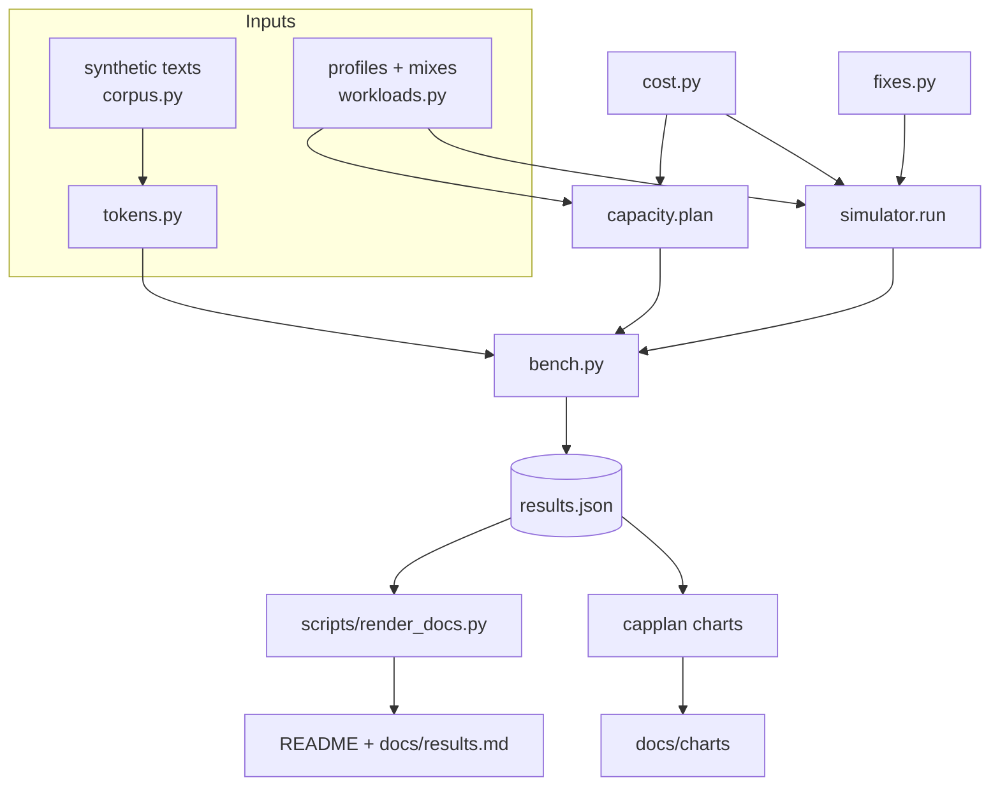

# Architecture

## Modules

| Module | Role |
| --- | --- |
| `tokens.py` | Offline approximate BPE counter (deterministic, used in CI); optional real cl100k via tiktoken |
| `corpus.py` | Seeded synthetic chat, contracts, code and articles for fictional companies |
| `workloads.py` | Clipped log-normal token distributions per profile, named mixes, percentiles, histograms, SVG bars |
| `cost.py` | Separate input and output prices; rejects negative, NaN, infinite and non-numeric inputs |
| `capacity.py` | Simulated hardware; plan(rps, sample) -> load, KV memory, replicas, percentiles, bills |
| `fixes.py` | Token bucket, caps with retrieval, tenant budget, drift monitor, FIFO and fair-share queues |
| `simulator.py` | Discrete-time fleet simulation with admission controls |
| `bench.py` | Every number in the docs |
| `cli.py` | `capplan` |

## How the planner works, step by step

1. Sample 20,000 requests from the mix (seeded).
2. Prefill tokens/s = RPS x mean input; decode tokens/s = RPS x mean output.
3. Sequences decoding at once (Little's law) = RPS x mean output x time per output token.
4. KV memory = those sequences x mean live context (prompt + half the answer) x bytes per token.
5. Replicas = the largest of: prefill load / (prefill rate x 60%), decoding sequences /
   (batch size x 60%), KV memory / (free memory x 60%). The binding resource is reported.
6. Unloaded service time per request = input / prefill rate + output x time per token; report
   p50/p95/p99. Cost per request likewise; monthly API bill = RPS x seconds per month x mean cost.
7. GPU bill = replicas x illustrative hourly rate x 720 hours.

## How the simulator works

- Poisson arrivals at the configured RPS for 60 s; each request has a user and a tenant.
  Whole-contract requests come from 100 "heavy" users in one tenant.
- Admission, in order: the RPS limit (a token bucket counting requests), input cap with retrieval
  and `max_tokens`, a KV-fit check, a per-user token bucket, a global token bucket.
- Admitted requests wait in a FIFO queue or a fair-share queue (least recent token usage first,
  with at most 8,000 prompt tokens in prefill per user at once).
- Every 10 ms each replica splits its time: the decode batch takes its share
  (live sequences / batch size), the rest goes to chunked prefill, shared equally by prompts in
  flight. A request is dispatched to the replica with the least pending prefill work that has
  both KV room and a free batch slot.
- Latency = finish - arrival; the run continues until the queue drains, so a backlog shows up
  in the tail.
