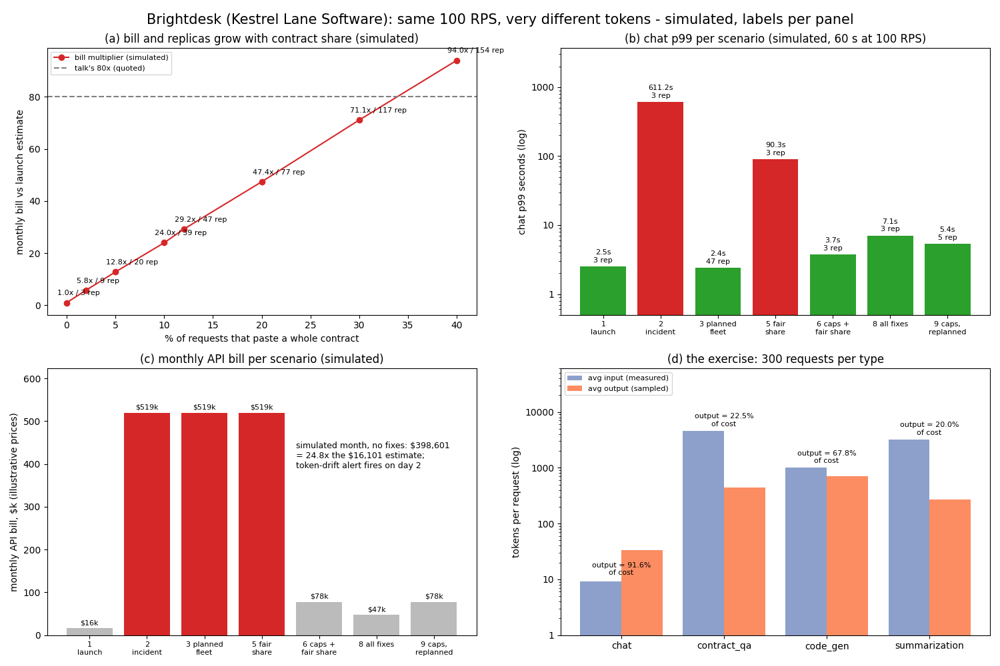

# Evidence board

Drawn by `python scripts/evidence_board.py` from the committed `results.json`; nothing is typed in by hand.
The numbers it plots are written to `docs/evidence_board.json`, and CI runs `--check` to fail if that file drifts
from `results.json` (PNG bytes vary by font and platform, so the JSON is what gets compared). Companies and
tenants are fictional. Prices are illustrative (as of 2026-10).

| Panel | Label | How to read it | Key numbers |
|---|---|---|---|
| (a) bill and replicas vs contract share | Simulated; dashed line quoted | Each point is a 20,000-request plan at 100 RPS with a bigger share of whole-contract requests | 0%: 1.0x, 3 replicas; 12%: 29.2x, 47; 40%: 94.0x, 154. The talk's 80x sits between 30% and 40% |
| (b) chat p99 per scenario | Simulated (60 s of traffic at 100 RPS) | Log scale; red bars are scenarios where chat users wait more than 10 s | launch 2.5 s; incident 611.2 s; fair share alone 90.3 s; caps + fair share 3.7 s on the same 3 replicas; 47-replica fleet 2.4 s |
| (c) monthly API bill per scenario | Simulated, illustrative prices | Adding replicas fixes latency but not the bill; only input caps lower it | incident $519k; caps + fair share $78k; all fixes $47k. Simulated month with no fixes: $398,601, 24.8x the $16,101 estimate; drift alert on day 2 |
| (d) the exercise | Inputs measured, outputs sampled | Average input vs output tokens per request type, with output's share of the cost | chat output is 91.6% of cost; contract Q&A 22.5%; summarization 20.0% |

**Takeaway:** the request rate never changed. Tokens per request did, and so did the bill and the tail.
Plan in tokens per second, cap inputs, and share capacity fairly between users.

**Regenerate:** `pip install -e ".[dev,board]" && capplan bench --write results.json && python scripts/evidence_board.py`.
