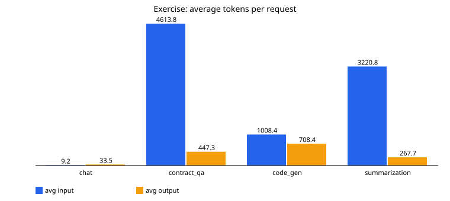
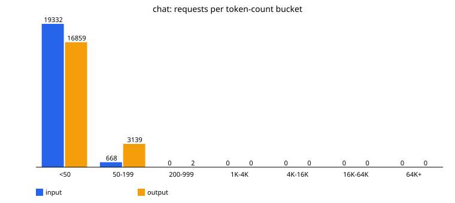
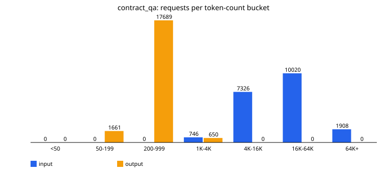
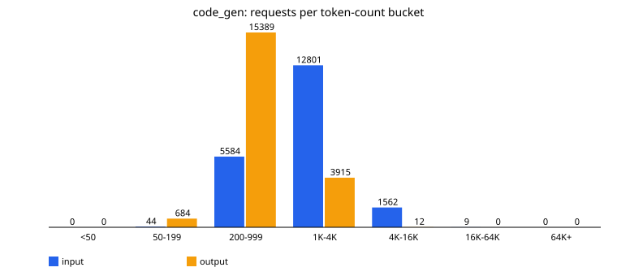
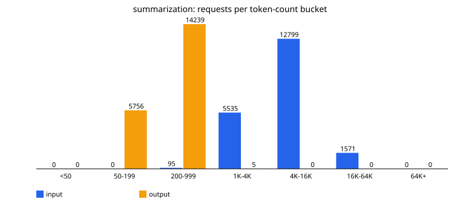

# The talk's exercise, done

The talk asks viewers to pick three or four kinds of request, measure average input and output tokens
for each, and draw a bar or frequency chart to see why each product needs its own estimate.

Method (`bench.exercise()`):

- 300 synthetic requests per type, built from the repo's corpus: a chat question; a contract of 20-400
  clauses plus a question; a code file of 5-60 blocks plus an instruction; an article of 30-300
  sentences plus "summarise in five bullets".
- Input tokens are **measured** with the offline counter on those texts.
- Output tokens are **sampled** from each workload profile (there is no real model generating answers),
  so they are simulated.
- Cost uses $0.50 / $1.50 per million input / output tokens.

<!-- exercise:start -->
| Request type | Requests | Avg input tokens | Avg output tokens | p99 input | Avg cost | Output share of cost |
| --- | --- | --- | --- | --- | --- | --- |
| chat | 300 | 9.2 | 33.5 | 14 | $0.000055 | 91.6% |
| contract_qa | 300 | 4,613.8 | 447.3 | 8,927 | $0.002978 | 22.5% |
| code_gen | 300 | 1,008.4 | 708.4 | 1,813 | $0.001567 | 67.8% |
| summarization | 300 | 3,220.8 | 267.7 | 5,623 | $0.002012 | 20.0% |
<!-- exercise:end -->

Frequency charts for each workload (20,000 sampled requests each):

What surprised us:

- For chat, output is almost all of the cost even though answers are short, because the questions
  are even shorter and output tokens cost three times more.
- For contract Q&A and summarisation it flips: input dominates cost, so input caps and retrieval
  matter far more than `max_tokens`.
- Code generation sits in between and is the one workload whose capacity is bound by decode
  (output) rather than prefill, which changes which GPU resource to buy.
