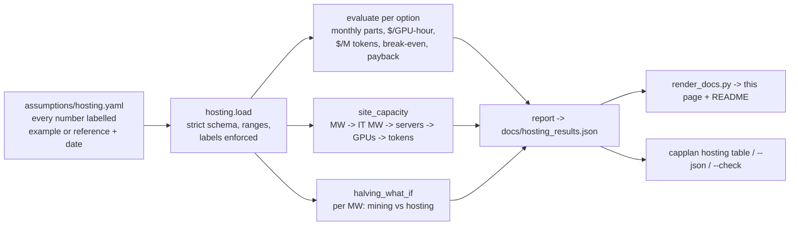

# Power-constrained AI hosting economics

**Summary.** Many people now say the limit on AI is no longer chips. It is power, land, cooling and
permits. This module is a calculator for that view. It takes one YAML file of labelled assumptions and
compares the cost per GPU-hour and per million tokens of three ways to host a model: (a) renting cloud
GPUs on demand, (b) owning servers in colocation at a converted power site, and (c) buying one small
server and running it on-prem. It compares each one with a per-token API price. It reports break-even
utilisation, payback time, the site's power ceiling and a halving what-if for mining sites. Every number
is a labelled example or a dated reference figure. The output is simulated economics, **not a quote, not a
forecast and not investment advice**. There are no Bitcoin price predictions anywhere.

## Background

The module explores a few common themes, in plain words:

- AI build-outs are slowed by grid connections, land, cooling and permits more than by GPUs.
- Sites that already have big power connections are worth a lot. Bitcoin mining sites are one example,
  and some miners are turning them into AI hosting.
- The next block-subsidy halving (expected around 2028) cuts mining revenue per unit of hashrate. That
  pushes more miners to look at hosting.

## Who it is for

- An engineer or architect asked "should we rent GPUs, buy them, or just pay per token?"
- A small team weighing a one-time server purchase (buy a small NVIDIA
  server once and run your own models on it) against cloud rental and APIs.
- Anyone who wants to see why **utilisation**, more than the power price, decides the cost per token,
  and why **power** decides how much you can build at all.

## Decision flowchart

```mermaid
flowchart TD
  A[New AI workload] --> B{Steady demand?<br/>Can you keep GPUs busy<br/>above the break-even utilisation?}
  B -- No, spiky or unknown --> API[Pay per token via an API<br/>or rent cloud GPUs only for the peaks]
  B -- Yes --> C{Data must stay on site,<br/>or a fixed one-time budget?}
  C -- Yes, small scale --> ONP[(c) On-prem small server, bought once<br/>check payback months and power in the room]
  C -- No --> D{Need more than a few<br/>servers of power?}
  D -- No --> E{Can you commit<br/>for 3-4 years?}
  E -- No --> CLOUD[(a) Cloud on demand or reserved<br/>flexible, highest cost per token]
  E -- Yes --> COLO[(b) Colocation]
  D -- Yes --> F{Is grid power available<br/>in time at a normal site?}
  F -- Yes --> COLO
  F -- No, power is the bottleneck --> G[Look at sites that already have power:<br/>converted mining or industrial sites]
  G --> COLO
  COLO --> H{Run capplan hosting with your own quotes.<br/>Still below API at your real utilisation?}
  ONP --> H
  H -- Yes --> GO[Proceed, and re-check every quarter]
  H -- No --> API
```

## How the module fits



## How it works, step by step

1. **Load and check the YAML.** Every number must be a mapping with `value` and `basis`. A `reference`
   basis needs an `as_of` date. Unknown keys, missing keys, bare numbers,
   NaN, booleans and out-of-range values (for example PUE below 1, utilisation of 0) are rejected with
   a clear message, and the CLI exits with code 2.
2. **Monthly cost per option** at utilisation `u`:
   - Cloud: `GPUs x $/GPU-hour x hours x billed fraction + other`. Always-on billing does not fall when
     GPUs sit idle.
   - Owned: the purchase as a level monthly payment (annuity at the cost of capital over the
     amortisation years), plus electricity, colocation fee and ops. Electricity is
     `max IT kW x (idle share + (1 - idle share) x u) x PUE x hours x $/kWh`. The colocation fee is
     charged on contracted (maximum) IT kW.
3. **Tokens per month** = `GPUs x tokens/s per GPU x 3,600 x hours x u`.
4. **Cost per million tokens** = monthly cost / tokens x 1,000,000. Compare it with the blended API
   price `(1 - output share) x input price + output share x output price`.
5. **Break-even utilisation.** Monthly cost is a straight line in `u` (`fixed + slope x u`), and the
   API bill for the same tokens is `API price x tokens at full load x u`. They meet at
   `u* = fixed / (API at full load - slope)`. If that is above 100%, the option never beats the API.
6. **Payback.** For owned options: purchase price / (monthly API bill for the same tokens - monthly
   running cost). There is none if running costs alone exceed the API bill.
7. **Power ceiling.** `site MW / PUE` gives IT MW. Dividing by the server's maximum draw gives
   servers, then GPUs and tokens per month. This is planned at maximum draw because breakers and grid
   contracts are sized for the peak.
8. **Halving what-if.** For 1 MW of facility power, hashrate is `IT watts / (J per TH)`. Revenue is
   `PH/s x hashprice x days`. After the halving only the subsidy part halves, so revenue becomes
   `revenue x (fee share + (1 - fee share) / 2)`. Everything else is held fixed on purpose. This is
   arithmetic on the inputs, not a forecast. Compare it with the colocation revenue the same MW could
   earn as an AI hosting site.

## Results (example assumptions)

<!-- hosting-results:start -->
All numbers below are generated by `capplan hosting --write docs/hosting_results.json` from the example
assumptions and checked in CI. They are simulated economics from labelled inputs, not measurements of a real site.

**Headline, at 60% utilisation:**

| Option | GPUs | $/month | $/GPU-hour | $/useful GPU-hour | $/M tokens | vs API | Break-even utilisation | Payback vs API |
| --- | --- | --- | --- | --- | --- | --- | --- | --- |
| (a) Cloud GPU, on demand | 8 | $24,860 | $4.26 | $7.09 | $0.7883 | 1.126x | 68% | n/a (rented) |
| (b) Colocation at a converted power site | 8 | $11,973 | $2.05 | $3.42 | $0.3796 | 0.542x | 32% | 17.0 months |
| (c) On-prem small NVIDIA server, bought once | 4 | $2,896 | $0.99 | $1.65 | $0.3826 | 0.547x | 32% | 13.8 months |
| Per-token API (blended) | - | - | - | - | $0.7000 | 1.0x | - | - |

**Where the monthly money goes:**

| Option | Monthly parts |
| --- | --- |
| (a) Cloud GPU, on demand | gpu_rental $23,360, other $1,500 |
| (b) Colocation at a converted power site | capex $7,548, electricity $497, colocation $1,428, ops $2,500 |
| (c) On-prem small NVIDIA server, bought once | capex $1,940, electricity $356, colocation $0, ops $600 |

**Cost per million tokens as utilisation changes** (the single biggest lever):

| Utilisation | (a) Cloud GPU, on demand | (b) Colocation at a converted power site | (c) On-prem small NVIDIA server, bought once | API |
| --- | --- | --- | --- | --- |
| 10% | $4.7298 | $2.2364 | $2.1587 | $0.7000 |
| 20% | $2.3649 | $1.1223 | $1.0931 | $0.7000 |
| 30% | $1.5766 | $0.7510 | $0.7379 | $0.7000 |
| 40% | $1.1825 | $0.5653 | $0.5603 | $0.7000 |
| 50% | $0.9460 | $0.4539 | $0.4537 | $0.7000 |
| 60% | $0.7883 | $0.3796 | $0.3826 | $0.7000 |
| 70% | $0.6757 | $0.3266 | $0.3319 | $0.7000 |
| 80% | $0.5912 | $0.2868 | $0.2938 | $0.7000 |
| 90% | $0.5255 | $0.2559 | $0.2642 | $0.7000 |
| 100% | $0.4730 | $0.2311 | $0.2406 | $0.7000 |

**Cost per million tokens as the power price changes** (everything else fixed):

| Electricity $/kWh | (b) Colocation at a converted power site | (c) On-prem small NVIDIA server, bought once |
| --- | --- | --- |
| $0.04 | $0.3726 | $0.3486 |
| $0.0721 | $0.3796 | $0.3590 |
| $0.1 | $0.3857 | $0.3681 |
| $0.1447 | $0.3955 | $0.3826 |
| $0.2 | $0.4076 | $0.4006 |
| $0.3 | $0.4294 | $0.4331 |

**Power ceiling of the site** (colo_converted_site, planned at maximum server draw): 20 MW of facility power
-> 16 MW of IT -> 1,568 servers, 12,544 GPUs in 523 racks ->
49,448.4 billion tokens a month, or 2,472.42 billion per MW.

**Halving what-if, per MW of facility power per month** (mechanical: every input fixed except that the block subsidy
halves; not a forecast of coin price, hashrate or fees):

| Line | Now | After the subsidy halves |
| --- | --- | --- |
| Hashrate | 52.91 PH/s | same |
| Mining revenue | $72,421 | $38,021 |
| Power at $0.0721/kWh | $52,633 | $52,633 |
| Mining margin | $19,788 | -$14,612 |
| Colocation revenue if converted (power passed through, before conversion cost) | $112,000 | $112,000 |

Hashprice the site would need after the halving just to cover power: $62.29/PH/day
(the example input is a fixed number, not a prediction).
<!-- hosting-results:end -->

## What the example numbers say (and do not say)

- **Utilisation is the biggest lever.** Owned hardware beats the example API price only above about
  32% utilisation. Always-on cloud needs about 68%. Below that, pay per token.
- **Power price is a small line on the bill but the main limit on scale.** Moving electricity from
  $0.04 to $0.30/kWh changes the colocation cost per token by roughly 15%. But the 20 MW connection
  caps the site at a fixed number of GPUs no matter how much money is available. That is the "power
  is the bottleneck" point in numbers.
- **The halving squeezes mining margins under fixed inputs.** With the example hashprice and power
  price, the mining margin per MW turns negative when only the subsidy halves. The same MW earns far
  more as colocation, before the real cost of converting the site (cooling, networking, power
  distribution, fit-out), which is not modelled.
- **None of this says what anyone should invest in.** Change the YAML to your own quotes. The answer
  can flip.

## Assumptions used (generated from the YAML)

<!-- hosting-assumptions:start -->
| Field | Value | Basis | Note |
| --- | --- | --- | --- |
| `hours_per_month` | 730 | example | 8,760 hours a year / 12 |
| `utilisation` | 0.6 | example | share of provisioned GPU time doing useful work |
| `api.input_usd_per_m` | 0.5 | example | same illustrative fictional-model price as cost.py |
| `api.output_usd_per_m` | 1.5 | example | output priced 3x input, as in cost.py |
| `api.output_token_share` | 0.2 | example | share of all tokens that are output tokens |
| `options.cloud_on_demand.gpus` | 8 | example |  |
| `options.cloud_on_demand.usd_per_gpu_hour` | 4.0 | example | on-demand list prices vary a lot by provider, region and GPU; use your own |
| `options.cloud_on_demand.billed_hours_fraction` | 1.0 | example | 1.0 = always on; set it to the utilisation if you truly scale to zero |
| `options.cloud_on_demand.other_usd_per_month` | 1500 | example | storage, egress, support plan |
| `options.cloud_on_demand.tokens_per_s_per_gpu` | 2500 | example | blended input+output tokens/s at full load; measure with a load test |
| `options.colo_converted_site.gpus_per_server` | 8 | example |  |
| `options.colo_converted_site.servers` | 1 | example |  |
| `options.colo_converted_site.server_capex_usd` | 300000 | example | 8-GPU server, delivered and installed |
| `options.colo_converted_site.amortisation_years` | 4 | example |  |
| `options.colo_converted_site.cost_of_capital` | 0.08 | example | yearly rate used to annuitise the purchase |
| `options.colo_converted_site.it_kw_per_server` | 10.2 | reference | as of 2024-04: typical published maximum system power of an 8-GPU H100-class server |
| `options.colo_converted_site.idle_draw_fraction` | 0.35 | example | power drawn at zero load, as a share of max |
| `options.colo_converted_site.pue` | 1.25 | example | power usage effectiveness of the converted site (facility kW / IT kW) |
| `options.colo_converted_site.electricity_usd_per_kwh` | 0.0721 | reference | as of 2026-08: published U.S. state industrial average retail price, 7.21 cents/kWh (preliminary) |
| `options.colo_converted_site.colo_usd_per_kw_month` | 140 | example | space, cooling and power delivery, charged per contracted IT kW; power itself passed through |
| `options.colo_converted_site.ops_usd_per_month` | 2500 | example | remote hands, network, monitoring |
| `options.colo_converted_site.tokens_per_s_per_gpu` | 2500 | example |  |
| `options.colo_converted_site.rack_kw_limit` | 40 | example | the power one rack at the site can deliver and cool |
| `options.onprem_small_server.gpus_per_server` | 4 | example |  |
| `options.onprem_small_server.servers` | 1 | example |  |
| `options.onprem_small_server.server_capex_usd` | 60000 | example | one-time purchase of a small 4-GPU server |
| `options.onprem_small_server.amortisation_years` | 3 | example |  |
| `options.onprem_small_server.cost_of_capital` | 0.08 | example |  |
| `options.onprem_small_server.it_kw_per_server` | 3.0 | example |  |
| `options.onprem_small_server.idle_draw_fraction` | 0.3 | example |  |
| `options.onprem_small_server.pue` | 1.56 | reference | as of 2024: published industry-average data-centre PUE; used as a stand-in for a small server room |
| `options.onprem_small_server.electricity_usd_per_kwh` | 0.1447 | reference | as of 2026-08: published U.S. commercial average retail price, 14.47 cents/kWh (preliminary) |
| `options.onprem_small_server.colo_usd_per_kw_month` | 0 | example | in your own building, so no colocation fee |
| `options.onprem_small_server.ops_usd_per_month` | 600 | example | part of one admin's time, spares, internet |
| `options.onprem_small_server.tokens_per_s_per_gpu` | 1200 | example | smaller GPUs serving a smaller model |
| `options.onprem_small_server.rack_kw_limit` | 8 | example | an office server-room rack |
| `site.power_mw` | 20 | example | grid connection of a converted site, in MW of facility power |
| `halving.hashprice_usd_per_ph_day` | 45 | example | revenue per PH/s per day today; an input, not a prediction |
| `halving.fleet_efficiency_j_per_th` | 18 | example |  |
| `halving.fee_share_of_revenue` | 0.05 | example | share of mining revenue from fees, which do not halve |
| `halving.mining_pue` | 1.05 | example |  |
<!-- hosting-assumptions:end -->

## Code excerpt and its real output

```python
def break_even_utilisation(o: Option, a: Assumptions) -> float | None:
    h = a.hours_per_month
    c0 = sum(monthly_parts(o, 0.0, h).values())
    c1 = sum(monthly_parts(o, 1.0, h).values())
    slope = c1 - c0
    api_at_full = monthly_tokens(o, 1.0, h) / 1e6 * a.api_blended_usd_per_m
    if api_at_full <= slope:
        return None
    u = c0 / (api_at_full - slope)
    return u if 0 < u <= 1 else None
```

`capplan hosting` (real output, example assumptions):

```text
Example assumptions, utilisation 60%, API blended price $0.7/M tokens
option                                          $/month  $/GPU-h  $/M tok  vs API  break-even util   payback
(a) Cloud GPU, on demand                        $24,860     4.26   0.7883   1.13x              68%         -
(b) Colocation at a converted power site        $11,973     2.05   0.3796   0.54x              32%   17.0 mo
(c) On-prem small NVIDIA server, bought once     $2,896     0.99   0.3826   0.55x              32%   13.8 mo

Site power ceiling (colo_converted_site): 20.0 MW -> 16.0 MW IT -> 1,568 servers, 12,544 GPUs, 49,448.4 B tokens/month
Halving what-if per MW (mechanical, not a forecast): mining margin $19,788 -> -$14,612/month; colocation revenue $112,000/month
All inputs are labelled examples or dated reference figures; this is not investment advice.
```

## How to run

```bash
pip install -e ".[dev]"
capplan hosting                                   # table above
capplan hosting --json                            # full report
cp assumptions/hosting.yaml my.yaml               # put your own quotes in, keep the labels
capplan hosting --assumptions my.yaml
capplan hosting --write docs/hosting_results.json && python scripts/render_docs.py   # regenerate docs
capplan hosting --check docs/hosting_results.json                                     # what CI runs
```

## Guardrails

- **Labels are enforced in code.** A number without `basis: example` or `basis: reference` plus an as-of
  date does not load. The report lists every reference value it used.
- **Strict schema.** Unknown keys fail loudly, so a typo such as `pue_` cannot silently fall back to a
  default.
- **Range checks.** PUE from 1 to 3, fractions from 0 to 1, whole numbers for GPU and server counts,
  finite numbers only.
- **Drift check.** CI re-runs the calculator and fails if `docs/hosting_results.json`, this page or the
  README block are stale.
- **No advice, no forecasts.** The halving section changes one input mechanically. A test checks that
  the YAML contains no price-target language.

## Limitations

- **The example inputs are not quotes.** GPU rental, server and colocation prices vary widely by
  provider, region, contract and month. Use real quotes.
- **Throughput is one number per GPU.** Real tokens/s depends on the model, batch size, context length
  and serving engine (see the capacity planner in this repo for prefill vs decode). Measure it with a
  load test.
- **Same quality is assumed.** The comparison only holds if the self-hosted model is good enough to
  replace the API model for the task.
- **Not modelled:** reserved or spot cloud discounts, staff beyond the ops line, network egress at scale,
  hardware failure and spares, resale value, taxes, power price contracts and demand charges, the cost
  and time of converting a mining site, permitting delays, and GPU supply lead times.
- **The power-draw model is linear** between idle and maximum. Real draw depends on the workload.
- **The halving what-if holds coin price, network hashrate and fees fixed,** which never happens. It
  shows the direction of pressure only.

## Related

- [cost.py](../src/capplan/cost.py) and the capacity planner in this repo: per-token prices and replica sizing.
- [Jagadish-azure-finops](https://github.com/jagadishmazure-jpg/Jagadish-azure-finops) for cloud cost governance.
- [Jagadish-inference-optimization](https://github.com/jagadishmazure-jpg/Jagadish-inference-optimization)
  for raising tokens per GPU, which lowers every cost per token here.
- ADR: [0004 labelled YAML assumptions for hosting economics](adr/0004-labelled-yaml-assumptions-for-hosting-economics.md).
